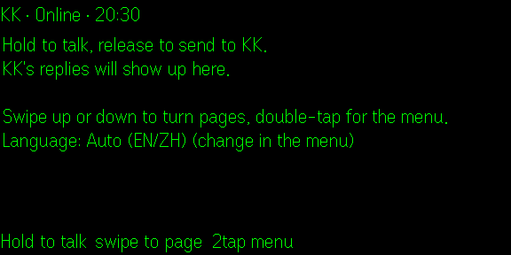
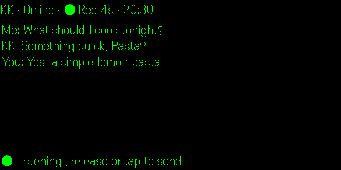
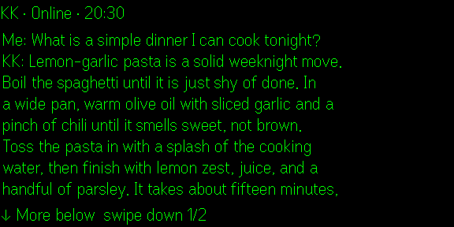
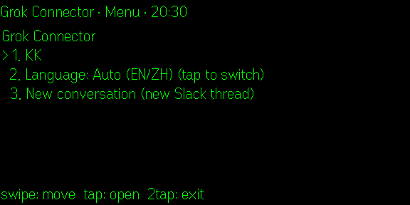
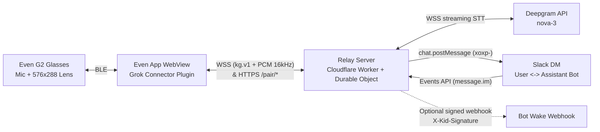

# Grok Connector (`kid-glasses`)

An open-source **Even Realities G2** smart-glasses plugin for Even Hub. Hold the temple touchpad to speak into the glasses microphone, stream live speech-to-text through **Deepgram**, send the message into a **Slack DM** with your AI assistant bot, and read replies paginated cleanly on the 576×288 lens display.

- **Glasses-mic-only capture:** requests `AudioInputSource.Glasses` exclusively and drops any frame not labelled from the glasses mic (enforced by static and runtime tests).
- **Live partial transcripts & letter-by-letter reply reveal:** see `你说：…` / live speech as you talk, then read assistant replies across auto-wrapped lens pages with swipe navigation.
- **Zero secrets in the plugin:** all Slack, Deepgram, and webhook credentials live in a self-hosted **relay server** — never inside the `.ehpk` bundle or client code.

## Screenshots

| Ready | Listening |
|---|---|
|  |  |

| Paged Reply | Menu |
|---|---|
|  |  |

## Architecture



1. **Pairing:** On first launch without a token, the plugin requests a 6-digit code (`POST /pair/start`) and shows it on the lens. Typing `配对 <code>` in your Slack DM with the bot mints a per-device token (`kgd_…`) stored only in the phone's Even bridge storage.
2. **Outbound voice turn:** Holding/tapping the temple streams 16 kHz mono PCM from the glasses mic over `wss://<your-relay>/device` to the relay, which opens a Deepgram streaming session, pushes `asr.partial` updates back to the lens, and posts the finalized transcript to your designated Slack DM (`KID_DM_CHANNEL_ID`). If your bot integration requires a direct trigger, the relay also sends an HMAC-signed `POST` to `KID_WEBHOOK_URL`.
3. **Inbound replies:** Slack delivers `message.im` events to `POST /slack/events`. The relay verifies Slack's HMAC signature, filters strictly to `KID_DM_CHANNEL_ID` (and optional bot allowlist), sanitizes Slack markup for the lens, and pushes `msg` frames over the WebSocket.
4. **Offline / transient recovery:** Pending voice transcripts and thread cursors survive WebView background reloads and transient Slack failures via an outbox with idempotent `cid` deduplication.

## Required Components

You will need four pieces to run your own instance:

1. **Even Realities G2 + Even App / Even Hub**
   - Paired G2 glasses and the Even Realities mobile app (≥ 2.2.10), plus an Even Realities developer account at [hub.evenrealities.com](https://hub.evenrealities.com/).
2. **Slack Workspace + Slack App**
   - A Slack workspace containing a direct message (`D…`) between you and your AI assistant bot.
   - A Slack App configured with **User Token Scopes** (`chat:write`, `im:history`, `im:read`) and **Event Subscriptions** subscribed to the user event `message.im`.
   - *(Optional)* An HTTPS webhook endpoint (`KID_WEBHOOK_URL` + `KID_WEBHOOK_SECRET`) if your Slack bot platform ignores messages created with a user OAuth token (`app_id` / `bot_profile`) and needs an explicit webhook wake-up.
3. **Relay Server — Cloudflare Workers + Durable Objects (Recommended)**
   - **Why Cloudflare Workers is strongly recommended:**
     - **Single-deploy WebSocket + state:** Cloudflare Workers paired with a SQLite-backed Durable Object (`RelayHub`) handles WebSocket hibernation, per-device pairing state, message history, and outbound Deepgram WebSocket streaming without managing servers, TLS certificates, or reverse proxies.
     - **Free-tier friendly:** `relay/wrangler.jsonc` uses `workers_dev: true` and `new_sqlite_classes` migrations, which work on the **Cloudflare Workers Free plan** (no paid plan or custom domain required for personal use).
     - **Isolated secrets:** API keys are stored encrypted via `wrangler secret put` and never bundled into the glasses `.ehpk`.
4. **Deepgram Account**
   - A [Deepgram](https://console.deepgram.com/) API key with access to streaming `nova-3` transcription (new accounts include free starter credit).

## Step-by-Step Setup

### 1. Deploy the Relay Server (Cloudflare Workers)

```bash
cd relay
npm install
npx wrangler login
npx wrangler deploy
```

Note the deployed Worker URL printed by Wrangler, e.g. `https://kid-glasses-relay.<your-subdomain>.workers.dev`.

Set all required secrets via `wrangler secret put` (**never** commit secrets into `wrangler.jsonc` or git):

```bash
npx wrangler secret put SLACK_USER_TOKEN       # xoxp-... User OAuth Token
npx wrangler secret put SLACK_SIGNING_SECRET   # Slack App Signing Secret
npx wrangler secret put KID_DM_CHANNEL_ID      # D... DM channel ID with your bot
npx wrangler secret put DEEPGRAM_API_KEY       # Deepgram API key
npx wrangler secret put DEVICE_TOKEN           # Generate with: openssl rand -hex 32
```

*(Optional)* If your assistant bot needs an explicit signed webhook wake-up:

```bash
npx wrangler secret put KID_WEBHOOK_URL        # https://... webhook endpoint
npx wrangler secret put KID_WEBHOOK_SECRET     # Generate with: openssl rand -hex 32
```

Verify configuration (returns booleans only, never secret values):

```bash
curl https://kid-glasses-relay.<your-subdomain>.workers.dev/health
```

See [`relay/README.md`](relay/README.md) for the complete relay protocol, webhook payload/signature spec, and troubleshooting.

### 2. Configure the Slack App

1. Open [api.slack.com/apps](https://api.slack.com/apps) → **Create New App** → **From a manifest**, select your workspace, and paste:

   ```yaml
   display_information:
     name: Grok Connector
     description: Voice relay for Even Realities G2 glasses
   oauth_config:
     scopes:
       user:
         - chat:write
         - im:history
         - im:read
   settings:
     event_subscriptions:
       request_url: https://kid-glasses-relay.<your-subdomain>.workers.dev/slack/events
       user_events:
         - message.im
     org_deploy_enabled: false
     socket_mode_enabled: false
     token_rotation_enabled: false
   ```

2. Install the app to your workspace (**OAuth & Permissions → Install to Workspace**).
3. Copy the **User OAuth Token** (`xoxp-…`) → `SLACK_USER_TOKEN` and **Signing Secret** → `SLACK_SIGNING_SECRET`.
4. Confirm **Event Subscriptions** shows **Verified** for `https://kid-glasses-relay.<your-subdomain>.workers.dev/slack/events`.
5. Open a DM with your assistant bot in Slack, copy its channel ID (`D…` from the browser URL or `conversations.list?types=im`), and set it as `KID_DM_CHANNEL_ID`.
6. *(Optional)* To pin which bot in the DM can push replies to your glasses, set `KID_BOT_ID` (`B…`) and/or `KID_BOT_USER_ID` (`U…`) in `relay/wrangler.jsonc` and redeploy.

### 3. Configure & Build the Glasses Plugin

From the repository root:

```bash
npm install
```

1. Update `app.json`:
   - Set a globally unique reverse-domain `package_id` (lowercase letters/numbers only, no hyphens, e.g. `com.yourname.grokconnector`).
   - Update `permissions` → `network` → `whitelist` to your relay domain (`https://kid-glasses-relay.<your-subdomain>.workers.dev` and `wss://kid-glasses-relay.<your-subdomain>.workers.dev`).
2. Point the build at your relay origin via `VITE_RELAY_ORIGIN` (or `.env.local`, which is gitignored):

```bash
VITE_RELAY_ORIGIN=https://kid-glasses-relay.<your-subdomain>.workers.dev npm run pack
```

This builds `dist/` and packs `grok-connector.ehpk` using `@evenrealities/evenhub-cli`.

### 4. Install on Even G2 (Beta / Private Build or QR Sideload)

1. Sign in at [hub.evenrealities.com/login](https://hub.evenrealities.com/login) with the same account used in the Even Realities mobile app.
2. Create an app and upload `grok-connector.ehpk` (via the portal or `npx evenhub create grok-connector.ehpk --name "Grok Connector" --tagline "Hold to talk with your AI on G2" --icon <24x24.png>`).
3. **Recommended — Beta build** (appears on the glasses menu and survives locked-phone backgrounding):
   - Add your Even account email under **Testing group** and accept the invitation email (`Status: Active`).
   - Click the build's `Private` tag → **Beta** → **Promote to Beta**.
   - In the Even Realities phone app: **Me → Beta tester → Install**.
4. **First-run pairing:** Open **Grok Connector** on your glasses. A 6-digit pairing code appears on the lens; type `配对 <code>` in your Slack DM with the bot to pair.

For fast local iteration without packaging, use `npm run simulate` with `@evenrealities/evenhub-simulator`.

## Configuration Reference

### Relay Secrets & Variables (`relay/`)

| Name | Kind | Description |
|---|---|---|
| `SLACK_USER_TOKEN` | Secret | User OAuth Token (`xoxp-…`) for posting to `KID_DM_CHANNEL_ID` |
| `SLACK_SIGNING_SECRET` | Secret | Slack App Signing Secret (`v0:ts:body` verification) |
| `KID_DM_CHANNEL_ID` | Secret | Single allowed Slack DM channel ID (`D…`) |
| `DEEPGRAM_API_KEY` | Secret | Deepgram API key for streaming STT |
| `DEVICE_TOKEN` | Secret | Master device token (≥ 32 chars) used for manual auth or admin recovery |
| `KID_WEBHOOK_URL` | Secret *(opt)* | `https://…` webhook URL called after each Slack post |
| `KID_WEBHOOK_SECRET` | Secret *(opt)* | HMAC-SHA256 secret for `X-Kid-Signature` |
| `DEEPGRAM_MODEL` | Var | Default `nova-3` |
| `DEEPGRAM_LANGUAGE` | Var | Default `multi` (used when lens language is Auto) |
| `DEEPGRAM_LANGUAGE_HINTS` | Var | Default `zh,en` |
| `FAST_LANE_ENABLED` | Var | Default `"false"` |
| `KID_BOT_ID` / `KID_BOT_USER_ID` | Var *(opt)* | Pin allowed assistant bot sender IDs in `relay/wrangler.jsonc` |

For local relay development, copy `relay/.dev.vars.example` to `relay/.dev.vars` (gitignored).

### Plugin Build-Time Config

- `VITE_RELAY_ORIGIN`: Relay HTTPS origin compiled into `dist/` (defaults to `https://kid-glasses-relay.your-subdomain.workers.dev`).
- `app.json`: Even Hub manifest (`package_id`, `name`, `version`, `min_sdk_version`, `permissions`, `supported_languages`).

## Development & Tests

```bash
# Plugin (from repo root)
npm run typecheck
npm test
npm run build
npm run pack

# Relay (from repo root)
npm run relay:typecheck
npm run relay:test

# Local simulator
npm run dev
npm run simulate
```

- **Plugin tests** (`tests/`): Vitest suite covering lens text wrapping/pagination, conversation state, progressive reveal, pairing/relay client reconnection & outbox recovery, `app.json` manifest rules, and static/runtime guarantees that only the glasses microphone is ever requested.
- **Relay tests** (`relay/test/`): Vitest suite covering Slack signature verification, `D…` channel allowlist enforcement, Deepgram streaming & fallback, pairing brute-force lockout, HMAC webhook signing, and content-free log guards.

## Security Notes

- **No secrets in client bundles:** `.ehpk` packages are extractable zip-like archives; never embed API keys or tokens in frontend code or `app.json`.
- **WebSocket auth off the URL/headers:** The plugin connects with public subprotocol `kg.v1` and sends `{"t":"auth","token":"…"}` as the first frame; unauthenticated sockets are swept after 10 s.
- **Single-channel Slack enforcement:** `KID_DM_CHANNEL_ID` must be a `D…` DM ID; `SlackClient` refuses all other channel IDs before making any outbound API call, and inbound events for other DMs are silently dropped without logging.
- **Content-free relay logs:** Relay logs record event types, status codes, sequence numbers, and byte/character counts — never message bodies, tokens, secrets, webhook URLs, or client IPs.
- **Glasses mic only:** `audioControl` is called only inside `src/lib/mic-control.ts` with `AudioInputSource.Glasses`.

## Project Structure

```text
.
├── app.json                 # Even Hub app manifest
├── index.html               # Phone-side WebView mirror page
├── package.json             # Plugin scripts & Even Hub SDK/CLI deps
├── src/
│   ├── main.ts              # Bridge boot & WebView mirror wiring
│   ├── app.ts               # Glasses state machine, menus, pairing & voice UI
│   ├── content/             # Glyph & capacity test pages
│   └── lib/                 # Display queue, lens wrapping, conversation, relay/pairing clients
├── tests/                   # Plugin Vitest suite
├── relay/
│   ├── wrangler.jsonc       # Cloudflare Worker + Durable Object config
│   ├── .dev.vars.example    # Local secret template
│   ├── src/                 # Worker router, RelayHub DO, Slack, Deepgram, webhook, pairing
│   └── test/                # Relay Vitest suite
├── docs/
│   ├── M0-REPORT.md         # G2 display, glyph & audio capability probe findings
│   └── screenshots/         # Store & probe screenshots
├── scripts/                 # Simulator & Cloudflare asset upload helpers
└── worker/                  # Optional static-asset + /echo Worker for QR dev mode
```

## Contributing

Issues and pull requests are welcome. Please run `npm run typecheck && npm test && npm run relay:typecheck && npm run relay:test` before submitting, and never include real tokens, channel IDs, or personal endpoints in commits or test fixtures.

## License

[MIT](LICENSE) © 2026 Fox Li
